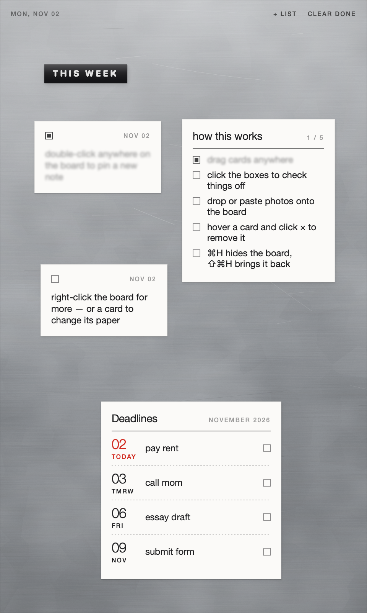

# Board

A todo board for your Mac that looks and feels like a sheet of steel on your wall — with notes, lists, deadlines and photos stuck to it.

It lives on your desktop: hide it with **⌘H**, bring it back from anywhere with **⇧⌘H**.



## Download

1. Download **Board-x.x.zip** from the [latest release](https://github.com/susiesyli/board/releases/latest).
2. Double-click the zip, then drag **Board** into your **Applications** folder.
3. Open Board. The first time, macOS will say it can't verify the app — Board isn't signed through Apple's paid developer program yet. To open it anyway:
   - Click **Done** on the warning.
   - Open **System Settings → Privacy & Security**, scroll down, and click **Open Anyway** next to the message about Board.
   - Confirm, and Board opens. You only need to do this once.

A short walkthrough starts on first launch.

**Needs:** macOS 14 (Sonoma) or newer, on an Apple Silicon Mac (M1 or later).

## How to use it

| To… | Do this |
|---|---|
| Pin a note | Double-click anywhere on the metal |
| Add a photo | Drop it on the board, or copy it and press ⌘V |
| Resize a photo | Click it, then drag any of its handles |
| Check something off | Click its box — finished things fade out of focus |
| Track a deadline | Write a date in a note (“essay fri”, “taxes nov 15”) and say yes to *Add to deadlines* |
| Move a card | Drag it |
| Move or resize the board | Drag bare metal / drag any edge |
| Remove a card | Hover over it, click ×, press Return |
| Hide / show the board | ⌘H / ⇧⌘H, or click the tab on the edge of your screen |
| Everything else | Right-click the metal or a card |

From the menu bar icon you can choose how the board sits on your screen — **floating** above everything, as a normal **window**, or **pinned** to the desktop behind your windows — turn on **Open at Login**, or replay the walkthrough.

Your board is saved on your Mac only (in `~/Library/Application Support/com.susiesyli.board`). Board never connects to the internet.

## Build it yourself

You need the Xcode Command Line Tools (`xcode-select --install`).

```sh
./build.sh            # builds build/Board.app
./build.sh --install  # also copies it to /Applications and opens it
./release.sh          # builds and zips it for a GitHub release
```
